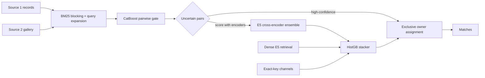

# Business Entity Matching

Link records that describe the same real-world business across two catalogs, even when the name, address, script, or language disagree. Each record on the left (source 1) may match at most one record on the right (source 2), and each right-hand record may be claimed by at most one left-hand record.

The catalogs mix Latin and Indic scripts, noisy addresses, missing fields, and near-duplicate legal names. The decision is not “are these two strings similar?” — it is “which unique partner, if any, is the same organization?”

Held-out test performance of the current cascade is **0.980 macro F0.5**, averaged per source-1 record (precision-weighted F-score, β = 0.5).

## How it works



1. **Lexical retrieval.** A disk-backed BM25 index over names and addresses, with learned query expansion and optional Indic transliteration, produces a short candidate list for every source-1 record.
2. **Pairwise gate.** A CatBoost classifier on lexical, numeric, and context features scores those pairs. Easy accepts and rejects stop here.
3. **Cross-encoder ensemble.** Remaining pairs are scored by eight fine-tuned multilingual-E5 checkpoints. The published score `c8` is the mean logit of the E5-small run and seven E5-base members.
4. **Stacker.** A histogram gradient-boosting model combines edit-distance / offset features, the gate logit, and the encoder logit. It is fit with GroupKFold by source-1 id so a record never leaks into its own fold. The selected recipe drops the country one-hot (`NOCTY`) and adds two name-feature blocks (`NAMEF`, `NAMEF2`).
5. **Recovery heads.** Dense E5 retrieval and exact-key channels (India / US identifiers that the BM25 list missed) add extra edges; they are stacked independently and merged at assignment time.
6. **Exclusive assignment.** `winner()` takes the scored edges of one source-1 record, applies a threshold (0.75 globally, 0.90 for France), and refuses a claim if a better source-1 already owns that source-2 record. A small text logistic model breaks remaining ties.

Encoders are hosted at [DeeAxe/business-entity-matching-encoders](https://huggingface.co/DeeAxe/business-entity-matching-encoders). The CatBoost gate and assignment policy ship in `model/`.

## What moved the score

The cascade was not designed in one shot. Each step below is a change that held up on the same held-out test, measured as per-source-1 macro F0.5.

| Stage | What changed | F0.5 |
| --- | --- | ---: |
| Lexical trees | BM25 + CatBoost on 50k labelled owners | 0.922 |
| Conflict handling | Pairwise text features for name/address disagreements | 0.932 |
| More labelled owners | Gate trained on 100k owners, broader retrieval | 0.953 |
| Exclusive assignment | One source-2 claim per record; text-scorer tie-break | 0.958 |
| Cross-encoder on the uncertain band | Fine-tuned multilingual-E5-small (1.3M pairs) | 0.976 |
| Encoder ensemble | Mean logit of E5-small + seven E5-base members (`c8`) | 0.977 |
| Dense recovery | E5 bi-encoder neighbours that BM25 never proposed | 0.977 |
| Exact-key channels | High-precision India/US key matches, France held at 0.90 | **0.980** |

A few design choices mattered more than extra model capacity:

- **Precision-weighted metric.** F0.5 punishes false matches harder than misses, so the assignment threshold sits high and France uses an even stricter cutoff.
- **Hard-negative mining.** Members `kD`/`kE` continue from `kA`/`kB` on a hard mix; `kF`/`kG` continue from mined out-of-fold errors. Averaging those specialists is what `c8` is for.
- **Owner-grouped stacking.** Features that look at the whole candidate list of a source-1 record (rank, gap to the best, count of strong rivals) only work if the stacker is cross-validated by owner, not by pair.
- **Full-gallery calibration.** Thresholds are chosen against the complete source-2 gallery, not a fold-restricted one. Fold restriction is used only for identity-safe training data.
- **Numeric band order.** Encoder score chunks are concatenated in numeric order (`0,1,2,…,11`), not lexicographic order, so the stacker sees the pair it thinks it sees.
- **Pinned bases.** `intfloat/multilingual-e5-small` and `intfloat/multilingual-e5-base` are loaded at fixed Hub revisions, and the eight fine-tunes are pinned to snapshot `9b04e5a37a28c9d73cd3dfa9953a399b8e18a81e`.

## Models

| Asset | Role | Where |
| --- | --- | --- |
| `gate0_100k/enhanced.cbm` | Pairwise CatBoost gate (100k owners) | [`model/gate0_100k/`](model/gate0_100k/) |
| `e5_cont1300k` | multilingual-e5-small, 1.3M pairs | Hugging Face |
| `kA`, `kB`, `kC` | multilingual-e5-base, 1.9M pairs, seeds 7/8/9 | Hugging Face |
| `kD`, `kE` | hard-mix continuations of `kA`/`kB` | Hugging Face |
| `kF`, `kG` | mined-error continuations of `kA`/`kB` | Hugging Face |
| `owner_assignment/policy.json` | `winner()` thresholds | [`model/owner_assignment/`](model/owner_assignment/) |

Download the eight encoder weights (about 8 GB) into `model/encoders/`:

```bash
python scripts/fetch_encoders.py
```

SHA-256 checksums are in [`model/encoders/SHA256SUMS`](model/encoders/SHA256SUMS). Rebuild the same eight checkpoints with [`scripts/train_encoders.sh`](scripts/train_encoders.sh).

## Setup

```bash
git clone https://github.com/Deep-Axe/business-entity-matching.git
cd business-entity-matching
python -m venv .venv && source .venv/bin/activate
pip install -e .
source scripts/env.sh
```

Point `BER_DATA` at a `dataset/` directory with `train/` and `test/` TSVs (`source_1`, `source_2`, and labels where you have them). Cross-encoder training and scoring need a second environment from `requirements.gpu.txt` (PyTorch 2.5, Transformers 4.48, `huggingface-hub`).

Useful environment variables, all set by `scripts/env.sh`:

| Variable | Default | Meaning |
| --- | --- | --- |
| `BER_DATA` | `$PWD/data` | Dataset root |
| `BER_WEIGHTS` | `model/encoders` | Fine-tuned `model.pt` files |
| `BER_HF_REPO` / `BER_HF_REVISION` | `DeeAxe/business-entity-matching-encoders` / `9b04e5a…` | Encoder snapshot |
| `CE_DATA` | `work/ce` | Pair pickles and score arrays |
| `BER_TEST_PARTITIONS` | `128` | Expected test partitions when `--strict` |

## Inference sketch

CPU path (index, features, gate):

```bash
python -m ber build-store  --data-dir "$BER_DATA" --output work/store
python -m ber build-index  --store work/store --output work/index
python -m ber features     --store work/store --index work/index \
                           --references "$BER_DATA/test/test_source1.tsv" \
                           --output work/features --unlabeled
python -m ber predict-shards --features work/features \
                             --model model/gate0_100k/enhanced.cbm \
                             --threshold 0.76 --output work/gate
```

Encoder + stack + assignment (GPU for scoring, CPU for HistGB):

```bash
python src/neural/ce_score.py --tag c8
NAMEF=1 NAMEF2=1 NOCTY=1 python src/neural/stack_eval.py c8 --test
python src/neural/test_submit.py --w 0 --t 0.75 --score stack_c8_nocty_nf2 \
  --country-t France=0.9 --extra-glob 'work/ce/dense/*.pkl' --extra-t 0.9 \
  --strict --out work/matches
```

`--strict` fails if any requested candidate route, declared test partition, or stack score file is missing. Full command sequences, including dense retrieval and the India/US key channels, are in [`docs/pipeline.md`](docs/pipeline.md).

## Layout

```
src/ber/          CPU matcher: store, BM25 index, features, CatBoost, CLI
src/neural/       Cross-encoders, dense retrieval, stacker, assignment
src/tools/        Feature caches, owner assignment, diagnostics
src/kaggle/       Training-job wrappers around the same encoder code
scripts/          env.sh, fetch_encoders.py, train_encoders.sh
model/            Gate, assignment policy, encoder checksums
```

## Authors

Deepam Ahuja, Varanasi Naga Akhil, and Lakshya Jain.

MIT license. Base E5 checkpoints remain MIT under their own terms.
